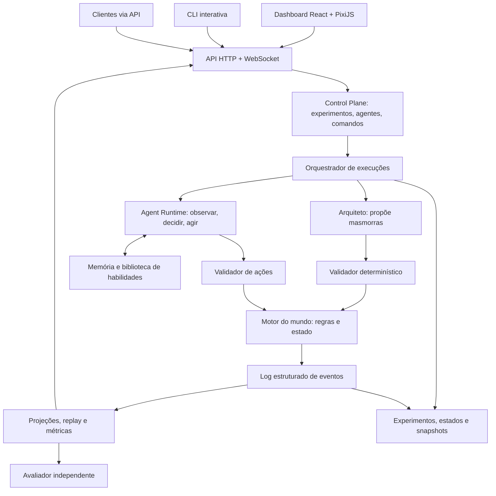
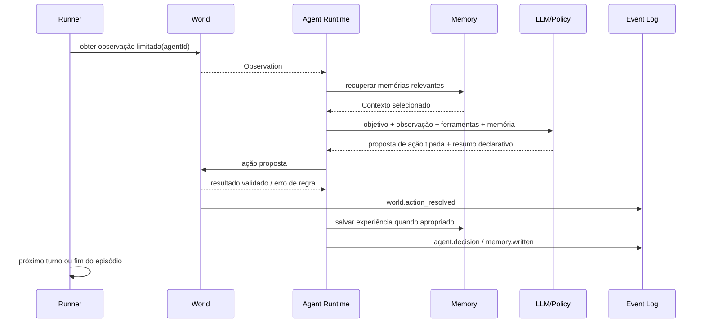

# 01 — Arquitetura do Dungeon Evolution Lab

## 1. Visão geral



**Separação fundamental:** quem define as consequências é o **Motor do Mundo**, não o LLM. O Arquiteto não consegue criar uma masmorra impossível sem que o Validador a rejeite (dentro das regras que o validador consegue verificar). O Avaliador não depende da avaliação subjetiva dos próprios competidores.

## 2. Componentes e responsabilidades

### Control Plane

- Cria/edita perfis e **versões** de agentes.
- Inicia, pausa, continua, finaliza, duplica e compara experimentos.
- Define seed, mapa, orçamento de ações/tokens/custo e limites de tempo.
- Controla permissões; alterações feitas ao vivo criam registro de intervenção.

### Dungeon Architect (gerador de desafios)

Entrada: dificuldade desejada, tópicos a testar, conjunto de recursos, restrições e resumo dos desempenhos anteriores (apenas treino).

Saída: **DungeonSpec** tipado, não código executável. Pode propor distribuição de salas, puzzles, oponentes, itens e lojas. Não tem acesso direto à base de métricas de teste cego.

### Dungeon Validator (regras verificáveis)

- Verifica esquema e limites de entidades.
- Confirma conectividade básica, restrições de energia/ouro, chaves e portas, e alcançabilidade da saída em modelo de estados simplificado.
- Exige soluções conhecidas ou resolvidas por verificador para cada puzzle incluído.
- Verifica limites de dificuldade, custo e condições de vitória.
- Pode rejeitar ou devolver razões de falha para revisão do Arquiteto.
- **Limite:** solucionabilidade formal depende de modelar integralmente as regras; puzzles complexos podem exigir solver especializado ou revisão humana.

### World Engine

- Máquina de estados para jogadores, mapa, inimigos, combate, compras, puzzles e objetivos.
- RNG com seed controlada para regras do mundo; ordem de turnos documentada.
- Aplica ações validadas e emite consequências objetivas.
- Nunca permite que um prompt altere diretamente HP, ouro ou status de vitória.

### Agent Runtime

Pipeline de cada turno:



**Observação importante:** `decision_summary` é uma explicação declarada do agente para auditoria, não sua cadeia de pensamento privada nem uma garantia de causalidade.

### Event Store + Projections

Eventos *append-only* (não editar registros anteriores) e snapshots periódicos. Interfaces e métricas consomem projeções desse log. Registrar id do experimento, episódio, turno, agente, versão, tempo, ação, observação, resultado, tokens e custo quando disponíveis.

O replay determinístico completo só é garantido se **ações já registradas** forem reproduzidas contra o motor versionado com a mesma seed. Uma nova chamada ao modelo pode divergir, ainda que use o mesmo prompt.

## 3. Modos de execução

| Modo | Como funciona | Uso |
|---|---|---|
| **Arena (MVP)** | Cada agente joga sua cópia isolada do mesmo desafio. | Comparar políticas sem interferência de outros jogadores. |
| **Cooperação** | Agentes compartilham uma mesma masmorra, itens ou mensagens segundo regras explícitas. | Coordenação, divisão de papéis, conflitos de recursos. |
| **Observador interativo** | Humano assiste, pausa, inspeciona, intervém ou bifurca simulação. | Debug, explicação e demonstração. |
| **Benchmark** | Execução repetível com versões congeladas e desafios ocultos. | Avaliar generalização e regressões. |
| **Sandbox** | Aceita mudanças ao vivo; marca execuções como intervencionadas. | Exploração criativa, sem contaminar resultados científicos. |

## 4. Ações e permissão

Tipos iniciais: `MOVE`, `INSPECT`, `INTERACT`, `ATTACK`, `DEFEND`, `BUY`, `USE_ITEM`, `WAIT`, `EXIT`.

- Ações inválidas não mudam o mundo; retornam erro estruturado observável.
- A ferramenta `BUY` só compra itens na loja atual, se houver saldo e estoque.
- `ATTACK` exige alvo e alcance válidos; dano é calculado pelo motor.
- `INSPECT` limita a percepção à informação que o agente pode legitimamente observar.
- O agente **não** recebe ferramentas de shell, rede, banco ou sistema operacional do host.

## 5. Separação de dados

- **Estado de mundo:** HP, ouro, inventário, posição, inimigos, puzzles, conteúdo visível.
- **Estado de agente:** identidade, versão, política, limites, objetivo, memória episódica, memória persistente e habilidades.
- **Estado da execução:** episódio, seed, relógio lógico, orçamento, eventos, status.
- **Estado da avaliação:** resultados agregados, intervalos de variabilidade, comparações, decisões de aprovação.

Entidades mínimas: `AgentVersion`, `DungeonSpec`, `DungeonInstance`, `Experiment`, `Episode`, `ActionEvent`, `MemoryRecord`, `SkillRecord`, `Snapshot`, `EvaluationResult`.

## 6. Stack recomendada e evolução

| Área | MVP | Evolução opcional |
|---|---|---|
| Linguagem | TypeScript/Node.js | Python para treinos RL especializados |
| Render | React + PixiJS | Camadas de animação, replay avançado |
| Backend | Node.js + HTTP + WebSocket | Workers/filas conforme escala |
| Banco | SQLite | PostgreSQL e busca vetorial se necessário |
| LLM | Adapter `ModelProvider` | OpenAI Agents SDK / provedores alternativos |
| Observabilidade | Eventos + dashboard próprio | OpenTelemetry e tracing exportável |
| Agent framework | Loop próprio, tipado | LangGraph para fluxos persistentes quando útil |
| Testes | Vitest + testes de propriedades | Benchmarks distribuídos |

**Decisão deliberada:** manter `WorldEngine` e `SimulationRunner` independentes do framework de LLM. Assim mudanças de SDK não obrigam reescrever regras nem invalidações experimentais.

## 7. Árvore de pastas planejada

```text
apps/
  web/                  # dashboard, editor de agentes, PixiJS
  api/                  # HTTP, WS, auth local, handlers
  cli/                  # terminal para operar o laboratório
packages/
  contracts/            # schemas + eventos + DTOs versionados
  world-engine/         # regras puras, RNG, puzzles, combate
  dungeon-generator/    # arquiteto + validador + geradores baseline
  agent-runtime/        # loop, tools, ModelProvider, memory
  simulation-runner/    # scheduler, filas, snapshots, budgets
  evaluation/           # métricas, datasets, estatística
  storage/              # repositórios e migrations
  ui-components/        # componentes gráficos reutilizáveis
experiments/
  benchmarks/           # cenários fixos; não expor seeds de teste ao treino
  samples/              # configurações de exemplo
  reports/              # resultados versionados
```

## 8. Restrições e riscos de engenharia

- **Custo:** limitar chamadas por episódio, cache em tarefas determinísticas e permitir agentes de regras como baseline.
- **Latência:** não esperar chamada LLM por quadro gráfico; o mundo avança por turnos lógicos e o front interpola animações.
- **Escala:** poucos agentes ativos na fase inicial; execução em fila para benchmarks extensos.
- **Concorrência:** uma ação transacional por entidade/turno; estado versionado para evitar compras simultâneas incompatíveis.
- **Segurança:** sem execução de código arbitrário gerado por agentes; quotas, allowlist de actions e logs auditáveis.
- **Privacidade:** evitar capturar segredos em traces/prompts; configurar redaction e retenção dos logs.